[](https://github.com/Bla-vk/terraform-aws-security-monitoring/actions/workflows/terraform.yml)

# AWS Security Monitoring with Terraform

Terraform project that sets up audit logging, threat detection and a least-privilege IAM example in an AWS account: a multi-region CloudTrail trail delivering to a locked-down S3 bucket, GuardDuty with email alerts, and a read-only IAM user whose permissions I tested with the IAM policy simulator. A GitHub Actions pipeline checks formatting, validates the code and scans it with Checkov.

Built as a hands-on project for my move into cloud and cloud security engineering. Everything is deployed with Terraform, tested, and then destroyed (see [Cost and cleanup](#cost-and-cleanup)).

## What it builds

15 resources in `eu-west-2`:

| Area | Resources |
|---|---|
| Audit logging | S3 log bucket (versioned, encrypted, public access blocked) with a bucket policy that only lets CloudTrail write to it; multi-region CloudTrail trail with log file validation |
| Threat detection | GuardDuty detector; EventBridge rule and target for findings; SNS topic, topic policy and email subscription |
| Least privilege | IAM user `security-monitoring-log-reader` with a policy scoped to read-only access on the log bucket; IAM Access Analyzer (account scope) |
| CI | GitHub Actions workflow (`terraform.yml`) with two jobs: `checks` and `security-scan` |

## Architecture

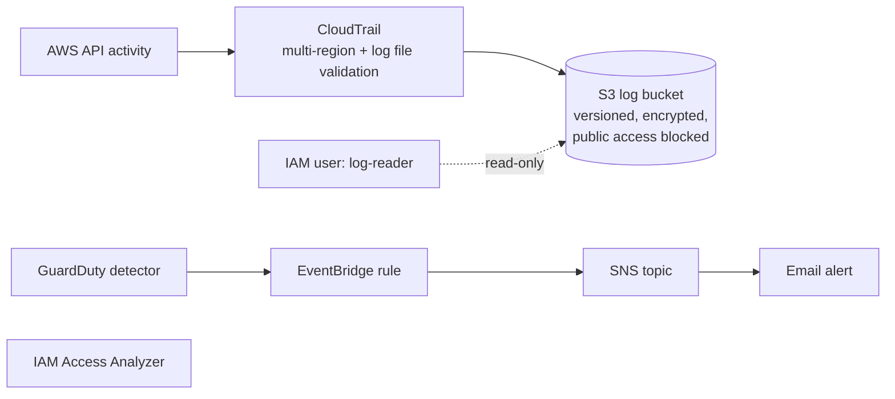

## Project structure

```
terraform-aws-security-monitoring/
├── .github/workflows/terraform.yml   # CI: fmt, init, validate, Checkov
├── providers.tf                      # provider, S3 remote state backend
├── variables.tf                      # region, project, alert_email
├── cloudtrail.tf                     # log bucket, bucket policy, trail
├── guardduty.tf                      # detector, EventBridge, SNS
├── iam.tf                            # log-reader user, policy, Access Analyzer
├── outputs.tf
├── terraform.tfvars.example          # copy to terraform.tfvars (not committed)
└── screenshots/
```

## How to run

Prerequisites: Terraform, the AWS CLI with a configured profile, an S3 bucket for remote state, and an email address for alerts.

1. Edit the `backend "s3"` block in `providers.tf` to point at your own state bucket.
2. Copy the example variables file and set your email:
   ```bash
   cp terraform.tfvars.example terraform.tfvars
   # edit terraform.tfvars: alert_email = "you@example.com"
   ```
3. Deploy:
   ```bash
   terraform init
   terraform plan
   terraform apply
   ```
4. Open the confirmation email from AWS Notifications and click **Confirm subscription**. Alerts are not delivered until you do.
5. When you are finished:
   ```bash
   terraform destroy
   ```

| Variable | Default | Purpose |
|---|---|---|
| `region` | `eu-west-2` | AWS region |
| `project` | `security-monitoring` | Prefix for resource names |
| `alert_email` | none (required) | Where GuardDuty alerts are sent |

Outputs: `log_bucket`, `guardduty_detector_id`, `log_reader_arn`, `access_analyzer_arn`.

## Results

Account IDs and personal identifiers are covered with grey boxes in all screenshots.

### Deployment

`terraform apply` created all 15 resources, and `terraform state list` shows the full inventory.

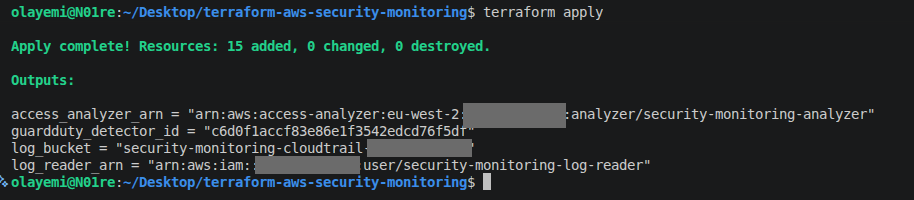
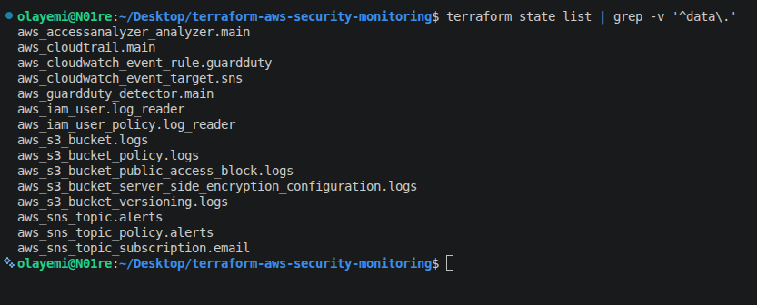

### CloudTrail records activity and delivers it to S3

The trail is multi-region with log file validation enabled and logging on. (SSE-KMS and SNS notification are not enabled; see [Limits](#limits).)

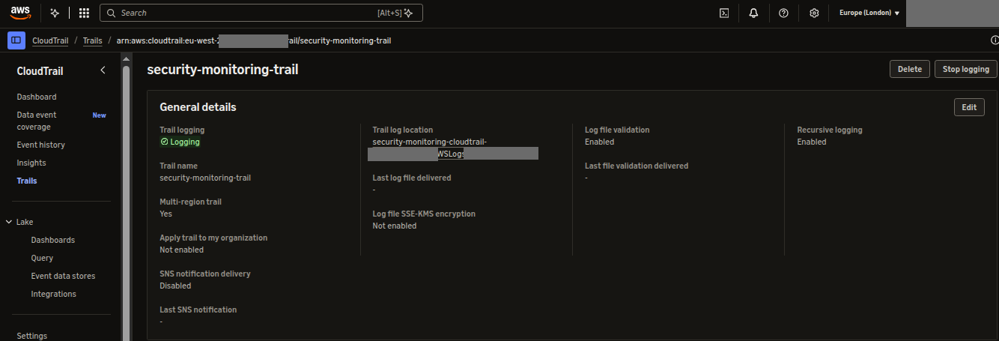

To test it, I created S3 buckets and then looked the events up. `lookup-events` reads CloudTrail event history, so it shows the action was recorded; the delivery to my own bucket is shown in the next two screenshots. Events from two different identities appear: my console user and my CLI profile (`vscode`).

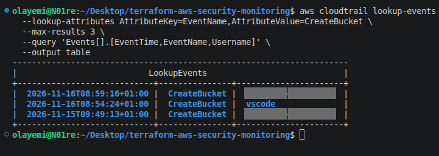

Log files arrived in the bucket under `AWSLogs/<account-id>/CloudTrail/<region>/`, from more than one region (eu-west-2, us-east-1 and us-west-2), which confirms the trail is capturing multi-region activity.

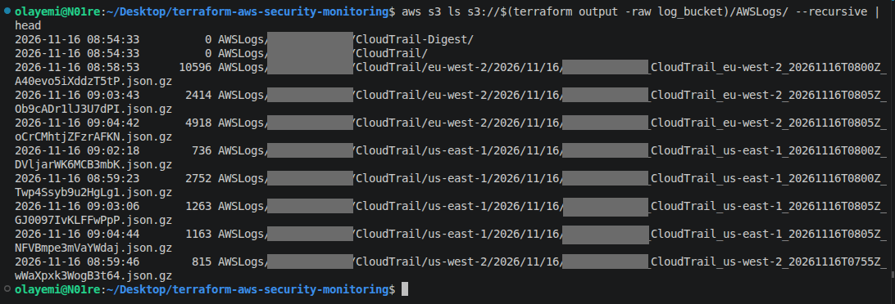
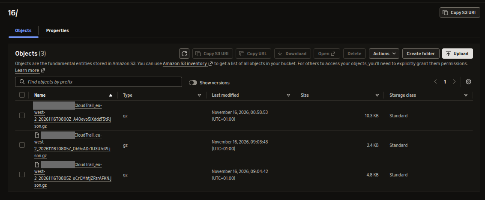

### The log bucket is locked down

Block Public Access is on for all four settings, and the bucket policy allows only the CloudTrail service to read the bucket ACL and write objects, with conditions that pin it to my specific trail (`aws:SourceArn`) and to the `bucket-owner-full-control` ACL.

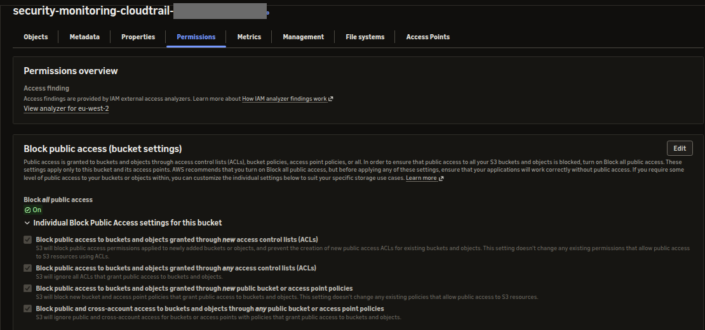
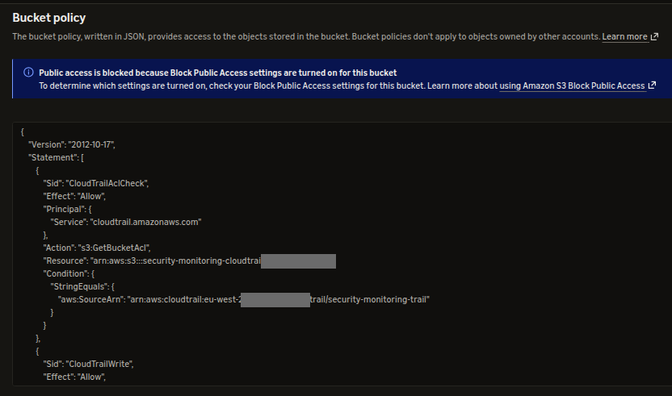

### GuardDuty detects and alerts

The detector is enabled. I generated a sample finding with `create-sample-findings`, it showed up in GuardDuty marked `[SAMPLE]`, and EventBridge forwarded it to SNS, which emailed me the finding as JSON.

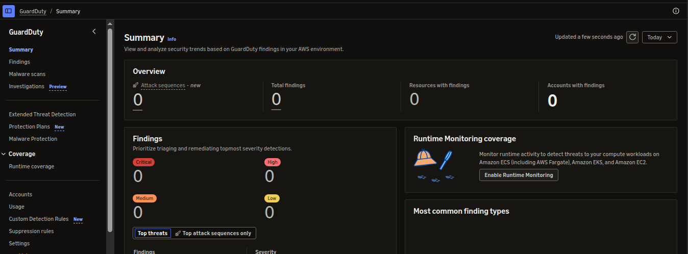
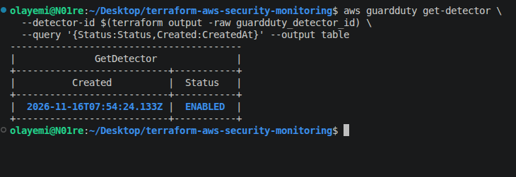
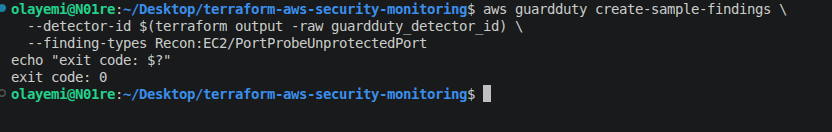
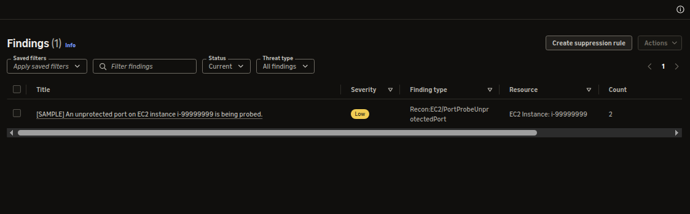
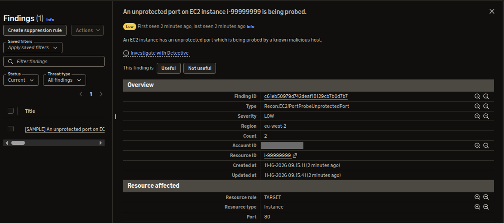
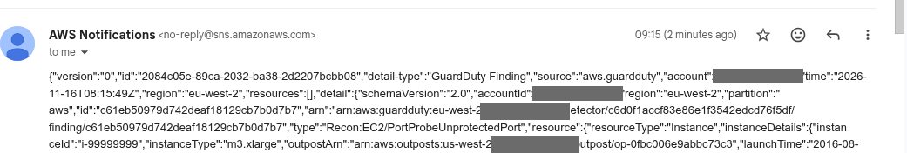

### Least-privilege IAM

I created the `log-reader` user with a deliberately over-broad policy (`s3:*` on `*`), proved it was too broad with the IAM policy simulator, then replaced it with a policy that allows only `s3:ListBucket` on the log bucket and `s3:GetObject` on its objects.

**Before:** all three actions are allowed.

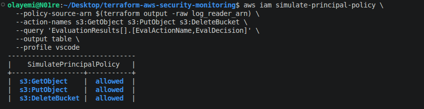

**After:** against an object in the log bucket, `GetObject` is allowed and `PutObject` is denied.


Against a different bucket, `GetObject` is denied, so the permission is scoped to the log bucket only.

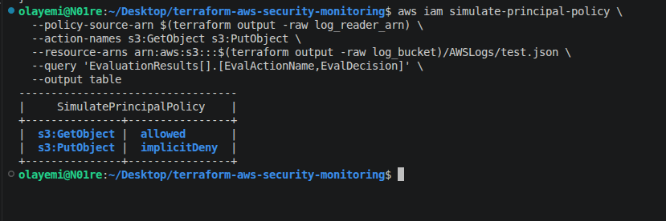

With no resource given, the simulator tests against `*`, and all three actions are denied.

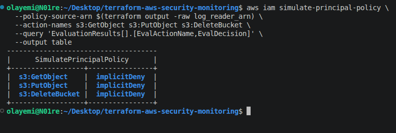

The Access Analyzer policy validator returned no findings. That shows the policy is valid, not that it is least privilege. A broad policy such as `s3:*` on `*` can pass validation, which is why I used the simulator to test the real effect.

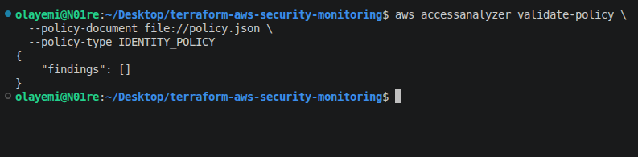

### CI pipeline

The workflow has two jobs. `checks` runs `terraform fmt -check -recursive`, `terraform init -backend=false` and `terraform validate` (no AWS credentials needed). `security-scan` runs Checkov in soft-fail mode, so it reports without blocking.

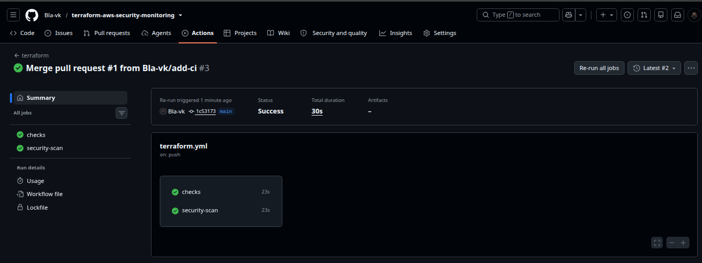

`main` is protected: changes need a pull request and a passing status check.

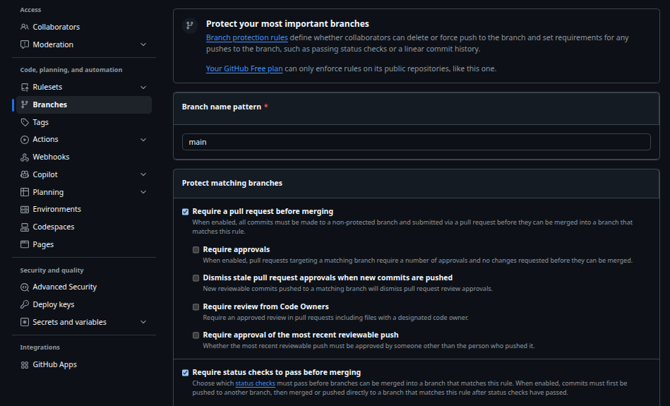

To prove the check works, I pushed a deliberate formatting error in `variables.tf` on a test branch. The pull request failed on `terraform fmt -check`, so `main` stayed protected.

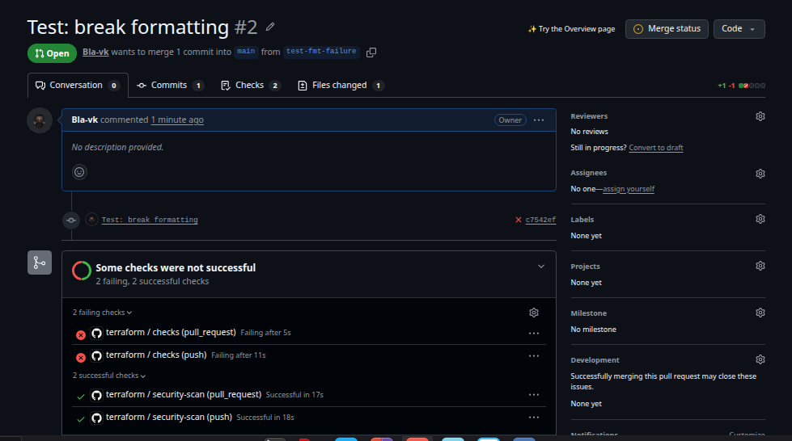
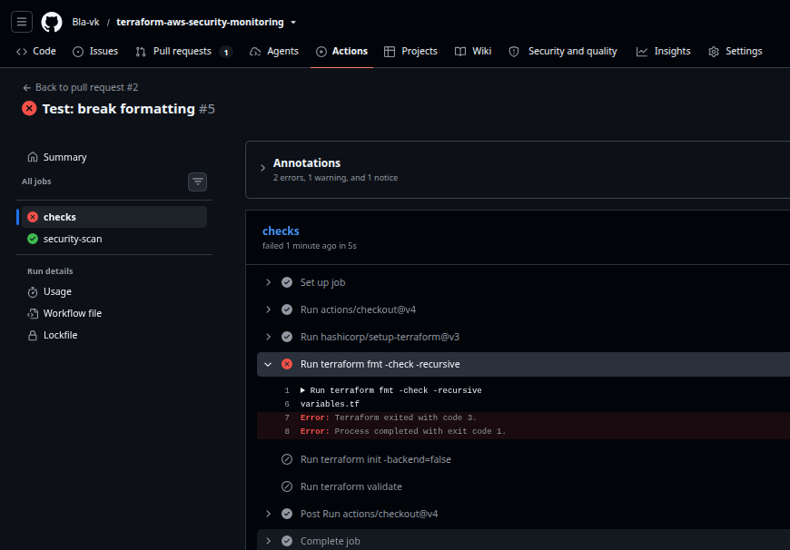

### What Checkov found

**Workflow file.** Checkov flagged my own workflow: `CKV2_GHA_1` (top-level `permissions` not set, so the token could default to write access). I added a top-level `permissions: contents: read` block, and the scan went from 39 passed / 1 failed to 40 passed / 0 failed.

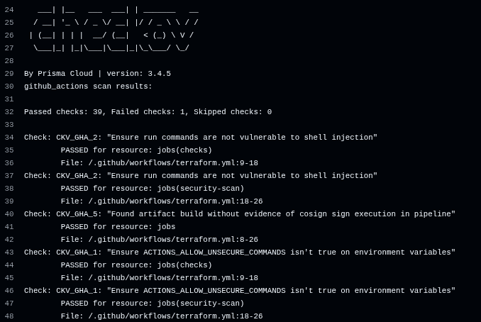
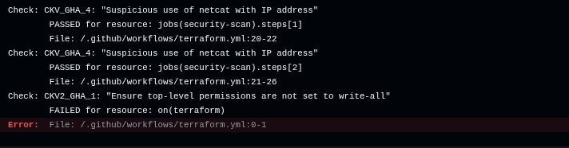
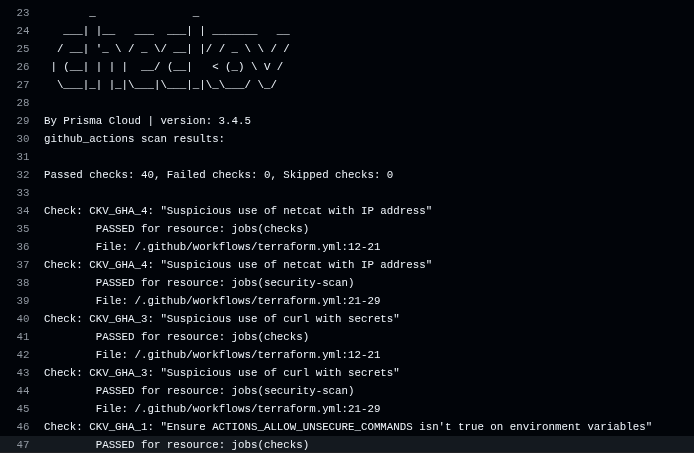

**Terraform code.** The scan reported 41 passed and 12 failed. I reviewed every finding and accepted all 12 for this lab. None of them is a mistake in the design, and each one is either extra hardening that adds cost or complexity, or a production-scale pattern that doesn't fit a single-account lab. They are documented here and in [Limits](#limits), and the ones worth doing are in [Next steps](#next-steps).

| Check | Resource | Finding | Decision |
|---|---|---|---|
| `CKV_AWS_35` | CloudTrail trail | Logs not encrypted with a KMS customer-managed key | Accepted. Logs use S3-managed encryption (AES256). A KMS key adds cost and key-policy complexity; listed as a next step |
| `CKV_AWS_145` | Log bucket | Bucket not encrypted with KMS by default | Accepted, same reason as above |
| `CKV_AWS_252` | CloudTrail trail | Trail has no SNS topic | Accepted. It would send a notification for every log file delivered. Alerting is handled by GuardDuty through EventBridge |
| `CKV2_AWS_10` | CloudTrail trail | Trail not integrated with CloudWatch Logs | Accepted for now. Listed as a next step (metric filters and alarms) |
| `CKV_AWS_18` | Log bucket | No S3 access logging | Accepted. It needs a second bucket to hold the access logs; listed as a next step |
| `CKV_AWS_144` | Log bucket | No cross-region replication | Accepted. Single-region lab; replication adds cost and a second bucket |
| `CKV2_AWS_61` | Log bucket | No lifecycle configuration | Accepted. The bucket is destroyed after each session, but a real one needs a retention rule; listed as a next step |
| `CKV2_AWS_62` | Log bucket | No event notifications | Accepted. Nothing in this project needs to react to bucket events |
| `CKV_AWS_26` | SNS topic | Topic not encrypted | Accepted. Encrypting it needs a customer-managed KMS key whose policy lets EventBridge publish (the AWS-managed SNS key does not allow that) |
| `CKV_AWS_40` | IAM user policy | Policy attached to a user, not a group or role | Accepted. A single test user exists only to demonstrate least privilege with the simulator |
| `CKV_AWS_273` | IAM user | Access should be controlled through SSO, not IAM users | Accepted. One lab user with no access keys created; a real setup would use IAM Identity Center |
| `CKV2_AWS_3` | GuardDuty detector | GuardDuty not enabled at the organization level | Accepted. Single account, no AWS Organizations |

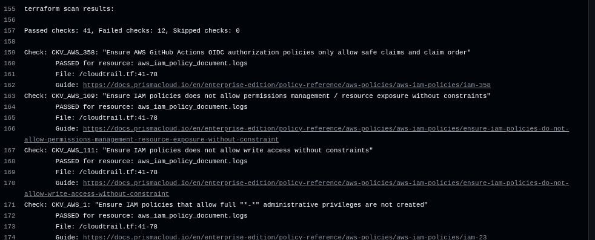
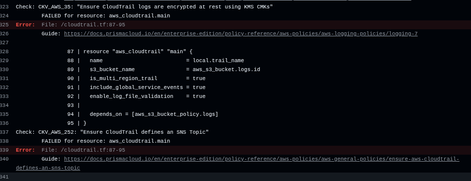

## Cost and cleanup

CloudTrail's first management-event trail is free, and S3 storage for a few log files costs very little. GuardDuty is free for a trial period and then billed by usage, so I destroyed the stack after testing.

`terraform destroy` removed all 15 resources, and the CLI confirmed no GuardDuty detector or CloudTrail trail remained.

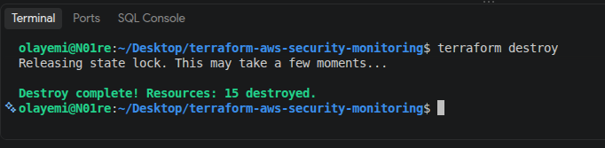
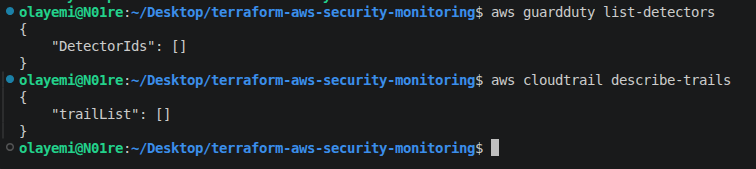

## Problems I hit and fixed

| Problem | Cause | Fix |
|---|---|---|
| `terraform plan`: "Reference to undeclared input variable" for `var.project` | I used `var.project` in `cloudtrail.tf` but had not declared it in `variables.tf` | Added a `variable "project"` block |
| The simulator showed all three actions denied after I tightened the policy | With no `--resource-arns`, the simulator tests against `*`, which the scoped policy does not allow | Passed `--resource-arns` for an object in the log bucket to test the intended access |
| Duplicated table and `:...skipping...` in the simulator output | The AWS CLI pager repainted the output | Use `--no-cli-pager` (or `AWS_PAGER=""`) |
| `git checkout main` refused: local changes to `variables.tf` would be overwritten | I had an uncommitted edit on my test branch | Commit, stash or restore the change before switching branches |
| Checkov flagged my own workflow (`CKV2_GHA_1`) | No top-level `permissions` block | Added `permissions: contents: read` |

## Limits

- Single account; no separate log-archive account and no AWS Organizations trail.
- Log bucket and trail use AES256 (S3-managed) encryption, not a customer-managed KMS key (`CKV_AWS_35`).
- The trail does not publish to SNS or CloudWatch Logs, so there are no CloudWatch alarms on API activity.
- GuardDuty was tested with sample findings only, not a real attack.
- `lookup-events` reads CloudTrail event history, which exists with or without my trail; log delivery to S3 is the proof that my trail works.
- Access Analyzer reports resources shared outside the account. It does not flag over-broad identity policies; the policy validator and simulator cover that, and the validator reported nothing for the policy I checked.
- The log bucket uses `force_destroy = true` so the lab can be destroyed cleanly. Remove that for production.
- Checkov runs in soft-fail mode, so its 12 open Terraform findings do not block the pipeline (all listed and explained in the Checkov section above).
- Tested in `eu-west-2` only.

## Next steps

- Encrypt the trail and bucket with a customer-managed KMS key.
- Send CloudTrail to CloudWatch Logs and add metric filters and alarms (root login, IAM policy changes, console logins without MFA).
- Add S3 access logging and a lifecycle rule on the log bucket.
- Make Checkov a blocking check once the open findings are resolved.
- Run `terraform plan` on pull requests using OIDC, as in my ECS project.
